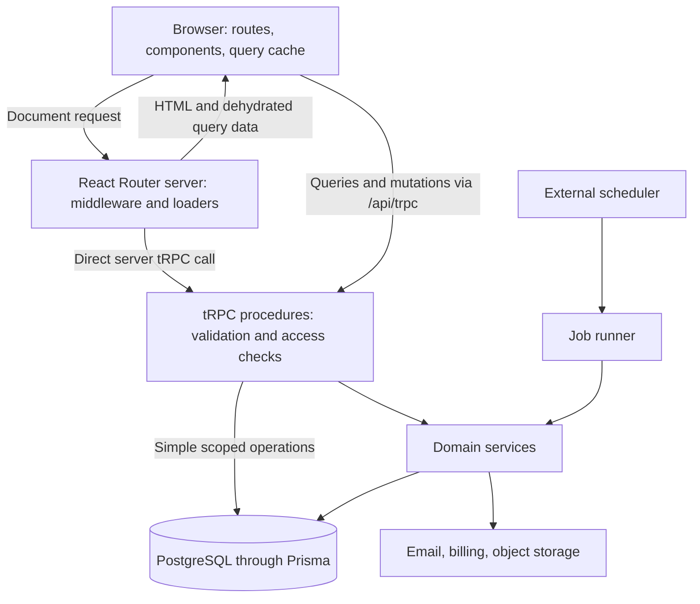

# System architecture

This guide describes the reusable application structure behind Jupiter. Use it to build another TypeScript product with the same boundaries, request flow, and development conventions. Replace scheduling features with the new product's domain rather than copying its business rules.

Jupiter uses a modular monolith: one React Router application contains the UI, typed API, authentication, and domain modules. PostgreSQL stores application data. A separately built job runner executes background work from the same codebase. Feature folders are code boundaries, not independently deployed services.

This document is the architecture overview. The linked guides define detailed [code organization](code-organization.md), [data handling](data-handling.md), and [routing](routing.md) conventions. The [Jupiter code map](../jupiter/code-map.md) describes the current product, rather than a required feature inventory.

## Building blocks

| Responsibility | Current choice | Boundary to preserve in another product |
| --- | --- | --- |
| Language | TypeScript | Share checked contracts across UI and server |
| Routing and rendering | React Router Framework Mode with SSR | Routes own URLs, navigation, route state, and initial rendering |
| Build | Vite | Separate browser assets, server application, and job entry point |
| Application API | tRPC with Zod validation and SuperJSON | Procedures enforce input and access rules; server types inform the client |
| Application data | TanStack Query | Queries own browser data, cache lifetime, refresh, and mutation reconciliation |
| Authentication | Better Auth | Resolve identity and sessions centrally |
| Persistence | Prisma with the PostgreSQL adapter | Keep database access on the server and enforce integrity in the database |
| UI | Shared UI primitives, Base UI, Tailwind CSS | Compose a shared component system before adding feature-specific controls |
| Forms | RVF through `AppForm` and `FormLabel` | Centralize submission behavior and field errors |
| Localization | i18next, translated resources, format preferences | Keep language, formatting preferences, and domain timezone explicit |
| External services | Server adapters for email, billing, and storage | Keep credentials and provider behavior behind server modules |

These libraries are the reference implementation. A replacement should preserve the ownership rules below, even if its API differs. Use the repository lockfile to reproduce installed versions.

## Runtime shape



The direct server caller and browser HTTP endpoint reach the same application router. SSR does not need an HTTP round trip back to its own API. The external scheduler is a deployment responsibility; building the runner does not schedule it.

## Repository structure

```text
app/
  routes.ts                       Explicit URL and route nesting configuration
  root.tsx                        Root state, providers, document shell
  entry.server.tsx                Server rendering entry
  middleware/                     Session, workspace, permission, locale context
  routes/
    layout.tsx                    Authenticated workspace shell
    <feature>/                    Route modules for a product feature
    api/                          HTTP adapters and resource endpoints
  components/
    ui/                           Existing UI primitives and their support code
    forms/                        Shared form compositions
    layout/                       Page and app layout components
    overlays/                     Shared dialogs, sheets, and confirmations
    <feature>/                    Feature UI, local hooks, and local types
  lib/
    trpc/                         Browser provider and server caller bridge
    auth/                         Auth configuration, client, permissions
    database/                     Server database client and ID helpers
    schemas/                      Shared feature input schemas
    query/                        Shared cache policies
    routing/                      Route state and navigation helpers
    localization/                 Language and formatting helpers
    <responsibility>/             Shared logic and server integrations
  .server/
    main.ts                       Composed application router and exported type
    trpc.ts                       Request context and procedure middleware
    routers/<feature>.ts          Feature API procedures
    services/<feature>.ts         Server domain workflows
    jobs/                         Background tasks and runner
  locales/<language>/             Translation resources
prisma/
  schema.prisma                   Active database schema
scripts/                          Setup, maintenance, and verification tools
tests/                            Domain and integration checks
docs/
  generic/                        Reusable application conventions
  <product>/                      Domain rules, deployment details, history
```

Create folders when they have a real responsibility. A small feature can start with a route, a router, and a form; it does not need an extra service or repository wrapper for every database call.

## Dependency rules

1. Routes compose components and coordinate route state. Register every URL explicitly in `app/routes.ts`.
2. Components use shared UI, feature helpers, and the browser tRPC client. They do not import runtime database clients, credentials, or server services.
3. Shared schemas and pure functions can be used on both sides. Keep browser-safe modules separate from modules with server imports or side effects.
4. tRPC routers select access middleware, validate inputs, and call domain services or perform simple scoped database operations.
5. Domain services own workflows, transactions, and business invariants shared by multiple procedures or jobs. They must receive enough trusted context to enforce tenant boundaries.
6. Jobs call server domain logic directly. They have no browser session, so tenant scope and authorization assumptions must be explicit at the job boundary.

Use `app/.server/` or `.server.ts` modules for server-only implementations. A route may use a server import inside its server loader; that import must not reach its browser component. Type-only imports of API contracts are appropriate. Prefer direct imports over barrel exports that mix server and browser modules.

Reusable component compositions belong in `app/components`, outside `ui/`. Feature-local hooks and types stay with their feature; shared non-rendering code belongs under the relevant `app/lib` responsibility.

## State ownership and request flow

| State | Owner | How it changes |
| --- | --- | --- |
| Session, language, theme, format preferences | Root loader and authentication layer | Auth operations or preference mutations followed by explicit revalidation where needed |
| Active workspace and setup redirects | Workspace middleware and layout loader | Workspace selection, onboarding, and explicit shell revalidation |
| Application records | tRPC and TanStack Query | Queries, mutations, cache updates, and invalidation |
| Shareable tabs, filters, selected resource | URL where appropriate | Router navigation and search parameters |
| Temporary interaction state | Component or feature hook | Local events, such as opening a menu or editing unsaved values |
| Persisted business truth | PostgreSQL | Validated server operations and background tasks |

### Initial visit

Middleware resolves request identity and locale. Root and layout loaders return shell state and enforce required redirects. A query-backed page loader creates its own query client, fetches through `createTRPC`, and returns a dehydrated cache. The server renders HTML; `TRPCReactProvider` hydrates that data in the browser. Server and browser queries must use the same procedure, inputs, and query keys.

Keep server query clients isolated. `getQueryClient()` creates a new client on each server call and reuses one in the browser. Within a loader, retain the local client used for fetching and dehydrate that same client.

### Client navigation

For query-backed pages whose loader only seeds SSR data, a no-op `clientLoader` returns `null`. Navigation can render the destination immediately, and its query uses cached data or displays a loading state while fetching. Root/layout revalidation rules separately control shell requests.

Do not apply this pattern to a loader that must supply route state or choose a redirect. Public pages may also need server errors with meaningful HTTP statuses. See [data handling](data-handling.md) for these distinctions and current cache defaults.

### Mutation

An RVF form calls a tRPC mutation through TanStack Query. The server validates input, resolves access, applies business rules, and persists the change. On success, the UI updates known cache entries and invalidates every affected query family before navigating when the destination requires fresh data.

Application forms do not use React Router actions. Resource routes can still export an action as an HTTP adapter: `/api/trpc`, for example, forwards requests into tRPC. This does not make router actions the application mutation layer.

Query invalidation and router revalidation serve different owners. Invalidate queries for changed records; explicitly revalidate loaders for changed shell state. Keep submit loading active through any destination loader work. Associate expected errors with inputs, use an error toast for unexpected submission failures, and use shared Alert components for page errors with retry behavior.

## Identity, tenancy, and access

The reusable model separates the user, session, workspace, and membership. Jupiter calls a workspace an `Organization`, and membership carries the user's role. An active workspace in a session is a selection, not proof that the user can access it.

Use middleware to establish request context and guide navigation. Enforce security again in tRPC procedures because API requests can bypass the page. Choose a procedure base for the operation's actual requirements: public, authenticated, workspace member, or permission-restricted. Subscription requirements are a separate policy and may need exceptions for account recovery and billing.

Scope tenant-owned reads and writes to the trusted workspace ID. When an input refers to another record, verify that record belongs to the same workspace before using it. Never authorize a write using only a client-supplied record ID or workspace ID. Jobs and public token flows need equivalent checks for their own access model.

Jupiter's procedure variants live in [tRPC context and middleware](../../app/.server/trpc.ts). Adapt roles, permission names, and subscription policy to the new product rather than treating every existing variant as interchangeable.

## Persistence and business workflows

The active schema is selected by [prisma.config.ts](../../prisma.config.ts), currently `prisma/schema.prisma`. `schema_blank.prisma` is a separate starting reference, not the active schema. Review both before deriving a product, and retain only the models and relationships the new product needs.

Keep constraints and multi-step invariants on the server. Use database constraints for uniqueness and references, and transactions for changes that must succeed together. For contention-sensitive operations such as capacity allocation, define how concurrent requests are serialized or rejected; a browser availability check cannot guarantee a later write succeeds.

Keep shared workflow logic in server services so API procedures and jobs use the same rules. Simple CRUD can stay in the router. Do not add Prisma access to route loaders; use the server tRPC bridge.

After a schema change in this repository, run both `npm run db:push` and `npm run db:generate`. The push script also runs integrity tooling. A derived deployment must define its own reviewed schema rollout and backfill process; do not copy a development reset command into deployment automation.

## Integrations and background work

Wrap external providers in server modules. UI and domain inputs should describe application intent rather than expose provider credentials or transport details. Treat provider callbacks as independent requests that require verification and safe handling of repeated delivery.

Move delayed, retryable work out of page rendering. Jupiter's [job runner](../../app/.server/jobs/runner.ts) is built separately and invoked with `npm run jobs:appointments`. It processes scheduling notifications, expiry, and cleanup. Another product should replace these tasks and decide its own cadence, retry policy, overlap protection, and monitoring.

Do not assume that using a job runner provides exactly-once execution. When delivery or cleanup may repeat, design the stored state and operation to tolerate retries. Keep database commits and external side effects coordinated deliberately; a database transaction cannot roll back an email already sent.

Email, billing, and object storage are optional product capabilities. Preserve their adapter boundary when replacing providers. Keep webhook handling, upload limits, cleanup rules, and operational setup in the product's own documentation.

## UI and localization

Build from shared UI primitives and shared page layouts. Keep forms, dialogs, tables, loading states, and errors consistent across features. Use the shared icon map for icons. Reset modal forms when a new create flow opens; do not reset while closing or immediately after submission. Nested modals must render their backdrop.

Keep translated text in locale resources and use `lib/localization/format-preference` for dates and numbers. Language, display format, and business timezone are separate decisions. Store and interpret domain dates according to explicit semantics, especially when an operation crosses timezones.

## Deployment boundary

Deploy the server build and browser assets from the same application build. Configure PostgreSQL, the canonical auth URL, secrets, and enabled providers through environment settings. Deploy and schedule the job artifact separately when the product needs it.

Production ingress must define trusted proxy headers and prevent direct access that bypasses those assumptions. Do not trust a forwarded client IP merely because the request contains a header. Rate limits and budgets that must work across application instances need shared persistence. Jupiter's exact deployment requirements are recorded in [security controls](../jupiter/security-controls.md); replace those details for a new environment.

Decide how the derived deployment monitors request failures, job failures, provider delivery, and database health. These are operational requirements to configure, rather than guarantees supplied by this folder structure.

## Implementing the structure elsewhere

1. **Define the domain.** Identify the workspace boundary, roles, primary records, public access flows, and business invariants. Replace Jupiter's scheduling terminology and policies.
2. **Establish the shell.** Set up TypeScript, SSR, explicit routes, providers, authentication, workspace context, and locale handling.
3. **Create the server boundary.** Add the database client, tRPC context, access middleware, composed router, HTTP endpoint, and direct server caller.
4. **Connect the cache.** Add request-isolated SSR query clients, browser hydration, shared query keys, and intentional freshness defaults.
5. **Build one complete feature.** Implement a scoped list, detail, create, edit, and delete flow with schemas, RVF forms, loading/error states, and cache reconciliation. Use the working feature as the project's reference.
6. **Extract shared pieces as needed.** Promote repeated components and workflows into their responsibility folders without creating layers that only forward calls.
7. **Add integrations and jobs.** Introduce only the providers and delayed tasks the product requires, including verification, retries, and cleanup.
8. **Document and verify.** Maintain a product code map and operational guide alongside generic conventions. Check tenant isolation, permissions, SSR hydration, direct URLs, client navigation, mutation freshness, and recovery paths.

For Jupiter, use `npm run typecheck`, focused existing tests, and `npm run build` when verifying implementation changes. Do not run lint. If testing starts a development server, shut it down before finishing. Database integration tests may require a configured database; inspect their setup before running them.

## Reference implementation

| Boundary | Code to inspect |
| --- | --- |
| Routes and shell | [Route configuration](../../app/routes.ts), [root](../../app/root.tsx), [workspace layout](../../app/routes/layout.tsx) |
| Request identity | [Authentication middleware](../../app/middleware/auth.ts), [Better Auth setup](../../app/lib/auth/server.ts) |
| API contract and access | [Application router](../../app/.server/main.ts), [procedure middleware](../../app/.server/trpc.ts) |
| Server and browser bridges | [Server caller](../../app/lib/trpc/server.ts), [HTTP adapter](../../app/routes/api/trpc.ts), [browser provider](../../app/lib/trpc/client.tsx) |
| Complete CRUD reference | [Notes route](../../app/routes/example/example.tsx), [notes router](../../app/.server/routers/example.ts), [note form](../../app/components/notes/note-form.tsx) |
| Persistence | [Database client](../../app/lib/database/prisma.server.ts), [active schema](../../prisma/schema.prisma) |
| Background execution | [Runner](../../app/.server/jobs/runner.ts), [job build](../../vite.jobs.config.ts) |

These links point to current Jupiter code. Revisit authorization policy and domain assumptions when copying an example; the reusable contract is the boundary and flow described above.
